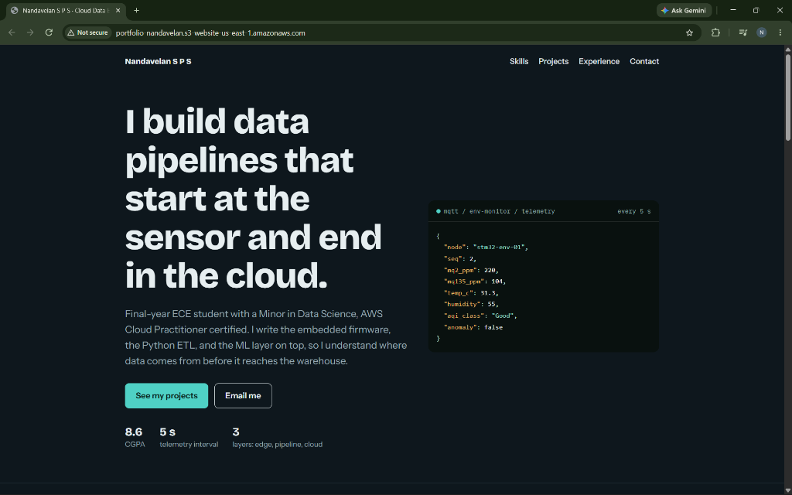
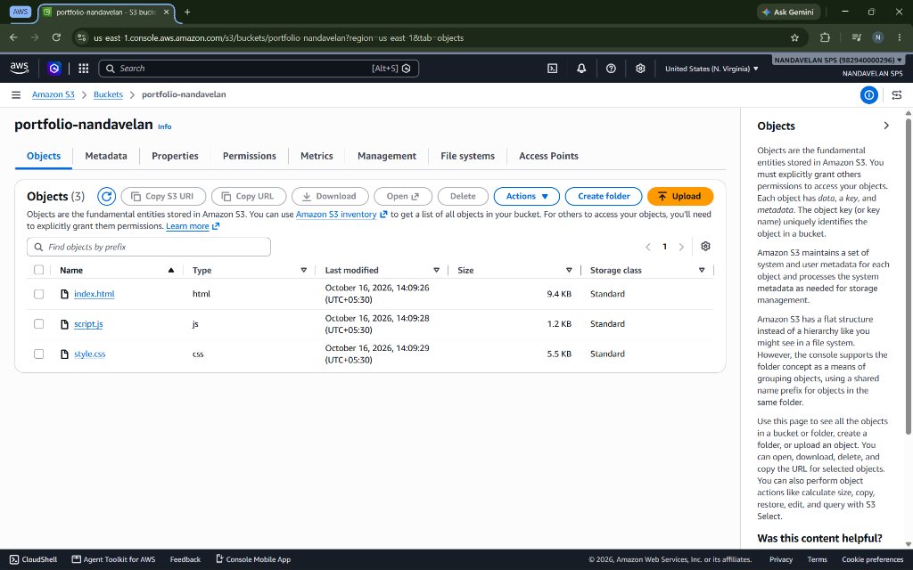

# 🌐 Personal Portfolio – AWS S3 Static Website Hosting

> A modern, responsive personal portfolio for **Nandavelan S P S** (Cloud Data Engineer & Embedded Systems Specialist), deployed and hosted globally using **Amazon S3 Static Website Hosting**.

---

## 🔗 Live Deployment

- **Live Website URL:** [http://portfolio-nandavelan.s3-website-us-east-1.amazonaws.com](http://portfolio-nandavelan.s3-website-us-east-1.amazonaws.com)
- **AWS S3 Bucket Name:** `portfolio-nandavelan`
- **AWS Region:** `us-east-1` (US East - N. Virginia)
- **Hosting Type:** Amazon S3 Static Website Hosting
- **Endpoint Format:** `http://<bucket-name>.s3-website-<region>.amazonaws.com`

---

## 📸 Screenshots

### 1. Live Portfolio Website


### 2. AWS S3 Console – Bucket Objects & Configuration


---

## 🛠️ Tech Stack & Services

| Layer | Technologies / Services |
| :--- | :--- |
| **Frontend** | HTML5, CSS3 (Modern Glassmorphism & Responsive Design), Vanilla JavaScript (ES6) |
| **Cloud Hosting** | Amazon Web Services (AWS) — Simple Storage Service (S3) |
| **Typography** | Google Fonts (Bricolage Grotesque, IBM Plex Mono, Instrument Sans) |
| **Version Control**| Git, GitHub |

---

## ☁️ AWS S3 Static Hosting Details

### Configuration Highlights
1. **Bucket Creation**:
   - Bucket Name: `portfolio-nandavelan`
   - Region: `us-east-1` (N. Virginia)

2. **Static Website Hosting**:
   - Enabled under Bucket **Properties** > **Static website hosting**.
   - **Hosting type:** Host a static website.
   - **Index document:** `index.html`.
   - **Error document:** `index.html`.

3. **Bucket Permissions & Public Access**:
   - Disabled "Block *all* public access" settings to allow public web traffic.
   - Attached S3 Bucket Policy granting public read permissions:
     ```json
     {
         "Version": "2012-10-17",
         "Statement": [
             {
                 "Sid": "PublicReadGetObject",
                 "Effect": "Allow",
                 "Principal": "*",
                 "Action": "s3:GetObject",
                 "Resource": "arn:aws:s3:::portfolio-nandavelan/*"
             }
         ]
     }
     ```

4. **Object Deployment**:
   - Deployed source files to the bucket root:
     - `index.html` (Core page structure and semantic markup)
     - `style.css` (Dark theme styling, typography, and responsive grid layout)
     - `script.js` (Simulated real-time MQTT telemetry ticker and project filter)

---

## 🚀 Features of the Portfolio

- **Interactive Telemetry Feed:** Real-time simulated sensor JSON payload displaying MQTT telemetry stream every 5 seconds.
- **Dynamic Project Filtering:** Interactive tabs allowing visitors to filter work between *Cloud & Data* and *Embedded & Edge*.
- **Three-Tier Architecture Overview:** Clear breakdown of Edge & Embedded, Data Pipelines, and Cloud & ML expertise.
- **High Performance & Lightweight:** Pure HTML/CSS/JS with zero heavy frameworks for instant loading from S3.

---

## 🔮 Future Enhancements

- [ ] **Amazon CloudFront CDN:** Enable low-latency global distribution and HTTPS (TLS) encryption.
- [ ] **Custom Domain (Route 53):** Map a custom domain name with SSL certificate via AWS Certificate Manager (ACM).
- [ ] **CI/CD Automation:** Set up GitHub Actions workflow to automatically sync updates from the `main` branch to the S3 bucket using `aws s3 sync`.